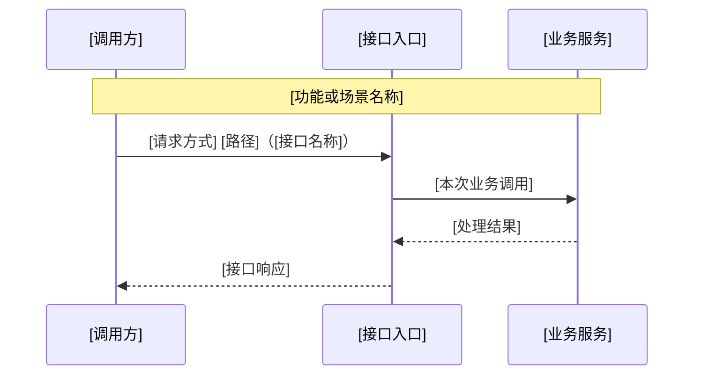

# [本次功能]接口文档

<!-- 只填写本次接口。成稿时删除全部占位内容和 HTML 注释；按请求方式加路径识别路由，按适用端区分契约，旧接口变化须有可定位的对比基线。 -->

**文档受众**：[客户端/管理平台/其他]

**适用 Web 端**：[具体端名称；非 Web 接口写“不适用”]

## 关键词定义

| 关键词 | 定义 | 适用功能或场景 | 需求或功能设计依据 | 同名定义的区别 |
|--------|------|----------------|------|----------------|
| [已确认业务术语] | [可核实的业务含义] | [本次接口场景] | [可定位的需求或设计位置] | [无或具体区别] |

<!-- 只保留影响本次接口理解的术语；优先沿用已有定义。实现位置仅核对事实，不替代设计依据；缺少设计依据的定义标为“待确认”，不得凭空造词或重新定义字段业务含义。 -->

## 接口汇总

| 业务场景 | 适用端 | 接口 | 用途 | 章节 |
|----------|--------|------|------|------|
| [场景名称] | [具体客户端、管理平台或 Web 端] | `[请求方式] [路径]` | [一句话说明] | 1 |

<!-- 每个接口契约独立一行；同一路由的分端契约有差异时分别列行，契约一致的共享接口列出全部适用端；不同 Web 端须写具体名称；业务场景与下方时序图名称对应，章节编号与接口标题一致。 -->

## 调用与逻辑链

### [功能或场景名称]



<!-- 多个功能或场景的链路不同时分别以三级标题和时序图列出；标题与图内名称一致，只保留能够从本次实现确认的节点。 -->

---

## 1. [接口名称]（新增接口/旧接口/待确认）

- **适用端**：[具体客户端、管理平台或 Web 端；共享时列出全部]
- **接口**：`[路径]`
- **请求方式**：`[GET/POST/...]`
- **请求类型**：`[实际 Content-Type；无请求体时按实际契约填写或写“无”]`
- **参数位置与组织**：[独立表单字段 / 字符串字段 `payload` 中的 JSON / JSON Body / 其他实际形式；无业务参数时说明请求类型要求]
- **说明**：[本次接口的用途]

### 参数

| 参数 | 类型 | 必填 | 说明 |
|------|------|------|------|
| [参数名或嵌套字段路径] | [类型] | [是/否] | [含义及必要约束] |

<!-- 表单契约的 payload 须在参数表中列出字符串字段及其 JSON 内部字段；JSON Body 须标明字段路径。无业务参数时写“无”并删除上表，但保留请求类型与参数组织说明。 -->

### 返回结果

<!-- 用本次实现的实际结构替换示例；非空对象或数组采用 2 空格缩进并展开嵌套结构，标量、null、空对象及空数组保持合法 JSON 原样；示例值须脱敏。 -->

```json
{
  "[返回字段]": {
    "[嵌套字段]": "[脱敏样例值]"
  }
}
```

**字段说明**

| 返回字段 | 说明 |
|----------|------|
| [字段名或嵌套字段路径] | [字段含义] |

### 本次变更（旧接口）

**对比基线**：[旧版为项目已确认的正式线上主分支名称、首次固定的已发布提交完整 Git SHA 及发布或部署证据；仅在主分支开发的项目补充目标环境实际使用的正式发布版本及其对应关系；无法确认适用基线时写“待确认”]

| 位置 | 字段 | 变化 | 说明 |
|------|------|------|------|
| [请求/返回] | [字段路径] | [新增/修改/删除] | [类型、必填性或默认行为的变化及兼容影响] |

<!-- 新增接口删除“本次变更”章节；旧接口无字段变化时写“无”，无法确认变更前契约时标题标“待确认”，本节写“待确认”。 -->

### 异常返回码

| 码类型 | 所在位置 | 返回码 | 说明 |
|--------|----------|--------|------|
| [HTTP 状态码/业务 errCode] | [HTTP 响应状态/响应体 errCode] | [本次接口实际返回的异常码] | [触发条件或错误含义] |

<!-- 业务参数异常按实际响应体 errCode 记录；表单框架参数映射失败按实际 HTTP 状态记录。两者数值同为 400 时仍分行记录，不得将 HTTP 400 当作业务 errCode。已核实没有异常码时写“无”；无法确认时写“待确认”。多个接口只复制分隔线至本注释之间的接口节并连续编号；新增接口优先追加，插入或删除时只调整必要的标题序号。 -->

## 公共说明

<!-- 汇总多个接口共用且已确认的请求与响应、鉴权、字段格式、状态与业务动作、分页、重试或新旧接口关系；仅保留本次实际存在的主题。接口特有约束留在对应接口节，无公共说明时删除本节。 -->

### [公共说明主题]

**适用接口**

- `[请求方式] [路径]`

**约定**

- [一项具体约定]

<!-- 多个适用接口或约定分别增加列表项；状态值等枚举改用“值/含义”表格，状态迁移或处理顺序用有序列表，默认值、单位与时间格式逐项列明，结果未知时的重试与查询步骤独立成节。已确认的例外或限制紧邻相关约定说明，不把不同主题压成一行。 -->
